<div align="center">



[](LICENSE)
[](quickpeek.py)
[-41CD52?logo=qt&logoColor=white)](quickpeek.py)

**Select a file in Dolphin, press Space, see what is inside.**
Previews for images, PDF, video, 3D models, code and more.

</div>

> **Hobby project.** I made this for fun, to learn. It has no goal beyond that. It comes with no support: issues are open but I cannot promise imminent fixes. It may break or change at any time.

## Highlights

| | |
| --- | --- |
| ⌨️ **One key** | Press Space in Dolphin to open, Space or Q to close. Arrow keys move through the folder in Dolphin's order. |
| 🔎 **Read what is in it** | Search PDFs, find and copy text in pictures (OCR), pick a subject with AI. |
| ✍️ **Annotate safely** | Draw, highlight and write on a PDF. The original never changes. |
| 🧊 **Native Qt 6** | Light and dark follow your system theme. |

## What it previews

- **Images:** zoom, pick a subject with AI, find and copy text in the picture (OCR), enlarge 2x or 4x.
- **PDF:** read, search, draw, highlight and write on it. The original is never changed: the edit is saved as a new PDF.
- **Word and e-books:** pages with text and picture selection.
- **Presentations:** slide by slide, with Morph transitions.
- **Spreadsheets:** `.xlsx`, `.xls`, `.ods`, `.csv`.
- **Video and audio:** playback, thumbnails, waveforms.
- **3D models and `.blend` files:** fly around the model with the mouse wheel and keys.
- **Revit, Affinity, Krita and Clip Studio files:** embedded preview.
- **Code and text:** syntax highlighting.
- **Archives, fonts and folders:** contents, font samples, icon grid.

Move between files in the same folder with the arrow keys, in the order Dolphin shows them.

Inside a preview:

| Key | Action |
|---|---|
| Space or Q | Close |
| Left, Right, Up, Down | Previous or next file |
| Return | Open with the default app |
| I or C | Details and tools panel |
| Ctrl+C, Ctrl+Shift+C | Copy file, copy path |
| F2, Delete | Rename, move to trash |
| F11 | Full screen |

Right-click in the preview for the file menu: Open With, Show in Folder, Set as Wallpaper.

## Install

On Arch, Fedora, Debian, openSUSE and distributions based on them:

```bash
curl -fsSL https://raw.githubusercontent.com/LaskyWolf/quickpeek/main/install.sh | bash
```

The script installs the Qt packages it needs with your package manager (it asks for your password through `sudo`), then puts KDEQuickPeek in `~/.local`. If your distribution's PySide6 lacks a part, it downloads PySide6 from PyPI instead (about 600 MB; the window then uses the plain Qt look instead of your Plasma theme).

Run the same command again to update. To uninstall:

```bash
curl -fsSL https://raw.githubusercontent.com/LaskyWolf/quickpeek/main/install.sh | bash -s -- --uninstall
```

On Arch or CachyOS you can build a package instead, from a clone of this repository:

```bash
makepkg -si
```

Both ways install `quickpeek`, `quickpeek-desktop`, the "Quick Preview" entry in Dolphin's right-click menu and a "KDEQuickPeek" entry in the application menu. The menu entry only opens a short window that says it works: previews start from Dolphin.

Some previews use other programs when they are installed: ffmpeg (video and audio), poppler (PDF thumbnails), 7zip or libarchive (archives), assimp and blender (3D models), krita, onlyoffice (Office files and presentations). See `optdepends` in `PKGBUILD` for the full list.

To make Space open quickpeek on desktop icons:

```bash
quickpeek-desktop install
systemctl --user restart plasma-plasmashell
```

Run `quickpeek-desktop install` again after every Plasma update.

AI models download on first use into `~/.local/share/quickpeek/models`.

## Tech stack

- Python 3 with PySide6 (Qt 6): widgets, Qt Quick 3D, Qt Multimedia, Qt PDF.
- Optional: PyMuPDF, ONNX Runtime (AI tools), NumPy, SciPy, Pillow, openpyxl, Pygments.
- Optional programs: ffmpeg, OnlyOffice, assimp, Blender, Krita, poppler, 7zip.

## Project structure

```
quickpeek.py          the app, one file
quickpeek-desktop.py  makes Space work on Plasma desktop icons
quickpeek.desktop     Dolphin right-click entry
quickpeek-app.desktop application menu entry
quickpeek.svg         icon
install.sh            curl installer
PKGBUILD              Arch package
test_quickpeek.py     tests
docs/                 notes
```

## Tests

```bash
QT_QPA_PLATFORM=offscreen python3 test_quickpeek.py
```

## License

GPL-3.0-or-later. See `LICENSE`.
